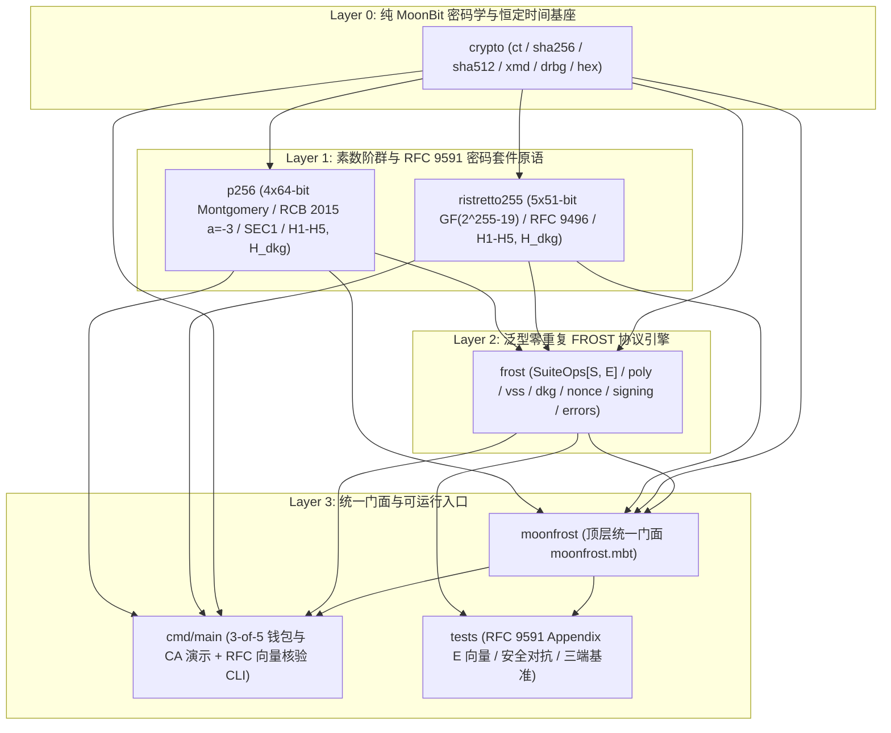
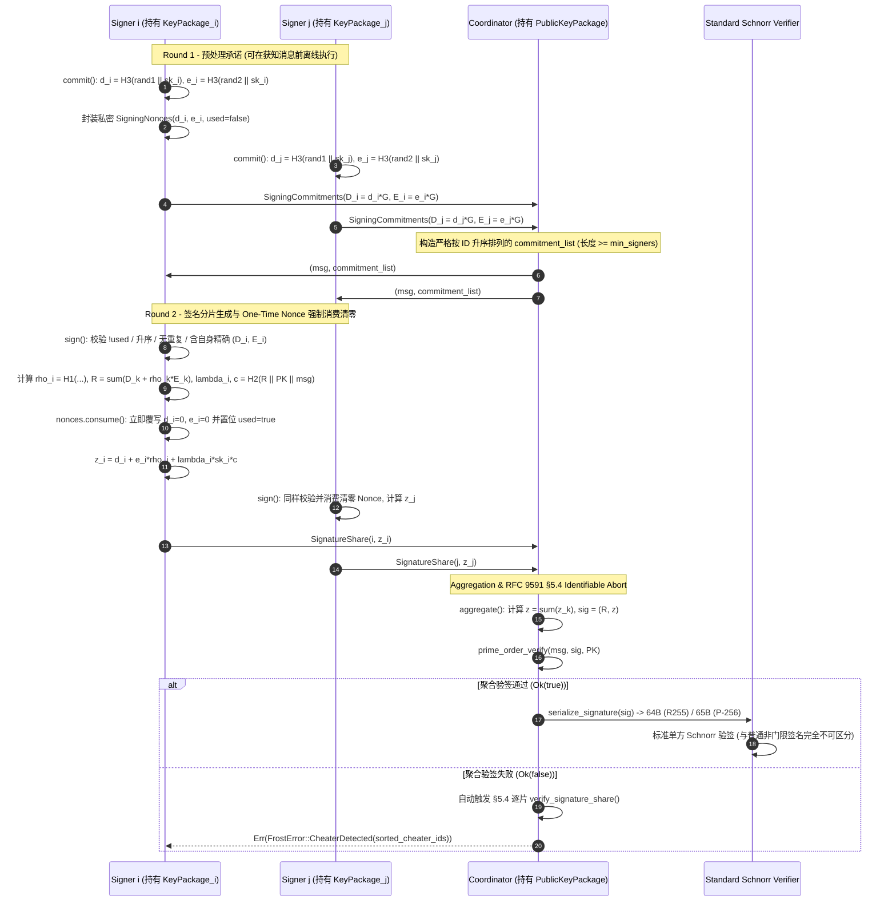
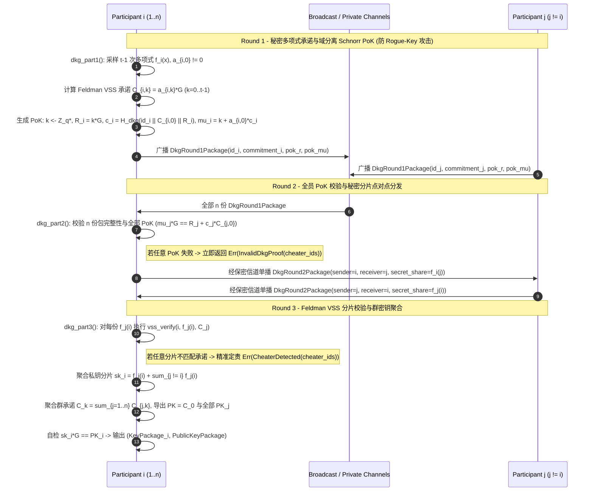

# MoonFROST 架构设计文档 (`CoolrfulDARkness/moonfrost`)

本文档详细阐述 `CoolrfulDARkness/moonfrost` 的分层架构、素数阶群数学与恒定时间防侧信道工程、`SuiteOps[S, E]` 泛型零重复引擎、IETF RFC 9591 两轮门限签名状态机、无中心三轮 Pedersen DKG 与 Feldman VSS 机制，以及全项目模块目录与公开 API 索引。

---

## 1. 分层架构总览

MoonFROST 采用严格的单向分层架构，全部代码使用纯 MoonBit 编写、零外部依赖、零 `extern` FFI，面向 `wasm`、`js`、`native` 三端统一编译并要求 `-d` 零警告通过。



### 架构设计原则

1. **零 FFI 与端到端内存安全**：全栈不引入任何 C/JS/Wasm 外部绑定，消除跨语言边界的缓冲区越界、悬垂指针与平台差异。
2. **密码学抽象与协议解耦**：通过泛型结构 `SuiteOps[S, E]` 将素数阶群运算与域分离哈希注入协议层，使得所有 FROST 协议算法、Feldman VSS、Pedersen DKG、Nonce 守卫和作弊者定责逻辑仅编写一份实现，完全消除双套件代码重复。
3. **默认安全（Secure by Default）**：
   - 底层群与域算术全面采用恒定时间（Constant-Time）算法；
   - 群元素编码与解码严格拒绝非规范编码及单位元（Identity Element）；
   - `SigningNonces` 内部字段严格私有（`priv`），强制一次性消费并立即清零。

---

## 2. 素数阶群数学与恒定时间防侧信道设计

IETF RFC 9591 §3 要求底层密码群为素数阶群（Prime-Order Group），以消除小阶子群（Small-Subgroup）与辅因子（Cofactor）相关攻击。MoonFROST 同时完整实现了 RFC 9591 官方定义的两个代表性素数阶群套件：

| 维度 | `FROST(ristretto255, SHA-512)` (RFC 9591 §6.2) | `FROST(P-256, SHA-256)` (RFC 9591 §6.4) |
| :--- | :--- | :--- |
| 域上下文字符串 | `"FROST-RISTRETTO255-SHA512-v1"` | `"FROST-P256-SHA256-v1"` |
| 元素编码长度 `Ne` | `32` 字节（RFC 9496 规范编码） | `33` 字节（SEC 1 压缩点 `0x02`/`0x03`） |
| 标量编码长度 `Ns` | `32` 字节（小端规范编码，`< l`） | `32` 字节（大端规范编码，`< n`） |
| 域表示 | `5 × 51-bit` UInt64 limbs（$\mathbb{F}_{2^{255}-19}$） | `4 × 64-bit` Montgomery 域（$\mathbb{F}_p$） |
| 标量表示 | `4 × 64-bit` 小端字 + 内部 Montgomery 乘法 | `4 × 64-bit` Montgomery 域（$\mathbb{F}_n$） |
| 点坐标与群律 | 扩展扭曲爱德华兹 $(X,Y,Z,T)$，Hisil 2008 完备公式 | 齐次射影 $(X:Y:Z)$，Renes-Costello-Batina 2015 $a=-3$ 完备公式 |
| 标量乘法策略 | 4-bit 固定窗口 + 16 项全表 CT 扫描 (`ct_lookup_point`) | 4-bit 固定窗口 + 16 项全表 CT 扫描 (`ct_table_lookup`) |
| 域/标量求逆 | 费马小定理恒定时间固定指数幂（$a^{p-2}, s^{\ell-2}$） | 费马小定理恒定时间固定指数幂（$a^{p-2}, s^{n-2}$） |
| 哈希到标量 | `SHA-512(DST \|\| msg) mod l`（64B 宽归约） | RFC 9380 `expand_message_xmd(SHA-256, L=48) mod n` |
| `H4` / `H5` 摘要 | `SHA-512(CTX \|\| "msg"/"com" \|\| m)`（64B） | `SHA-256(CTX \|\| "msg"/"com" \|\| m)`（32B） |

### 2.1 Ristretto255（RFC 9496）实现细节

- **`5 × 51-bit` $\mathbb{F}_{2^{255}-19}$ 素域算术 (`ristretto255/field.mbt`)**：
  - 将 255 位域元素拆分为 5 个 `UInt64` limb（每个 limb 保留 13 位冗余位用于延迟进位），所有规范化输出维持不变量 `l0, l2, l3, l4 < 2^51` 且 `l1 <= 2^51`。
  - 减法采用 `4p` 偏置（`P4_0`, `P4_1234`）确保永不发生无符号下溢；乘法采用无分支 64×64->128-bit 宽乘 `mul_u64_wide` 与 $2^{255} \equiv 19 \pmod p$ 快速折回。
  - 提供恒定时间 `sqrt_ratio_m1(u, v)` 同时判定平方剩余并返回 $\sqrt{u/v}$ 或 $\sqrt{i \cdot u / v}$，供编码、解码与 Elligator2 共用。
- **RFC 9496 群封装与无辅因子保证 (`ristretto255/ristretto.mbt`)**：
  - `RistrettoPoint` 将底层 `EdwardsPoint` 设为 `priv`，外部无法观察或构造非合法内部表示（符合 RFC 9496 §6）。
  - **编码 (§4.3.2 `encode`)**：通过 `sqrt_ratio_m1` 与恒定时间掩码选择 `Fe::ct_select` 规范化旋转与符号位，输出唯一 32 字节小端表示。
  - **解码 (§4.3.1 `decode`)**：严格拒绝长度非 32 字节、数值 $\ge p$、负元素（LSB 为 1）、非平方剩余、$t < 0$ 或 $y = 0$ 的非法编码。
  - **等价判定 (§4.3.3 `ct_eq`)**：恒定时间计算 $x_1 y_2 = y_1 x_2 \lor y_1 y_2 = x_1 x_2$，正确覆盖 8 阶陪集等价类。
  - **Elligator2 映射 (§4.3.4 `from_uniform_bytes`)**：将 64 字节均匀随机字节拆分为两段 32 字节，分别通过 Elligator2 映射为两个内部点后相加，得到均匀分布的 Ristretto255 群元素。
  - **RFC 9591 非单位元编解码**：`serialize_non_identity` 与 `deserialize_non_identity` 严格禁止单位元进入协议线格式。

### 2.2 NIST P-256（SEC 1 / RFC 9591 §6.4）实现细节

- **`4 × 64-bit` Montgomery 域与标量算术 (`p256/field.mbt`, `p256/scalar.mbt`)**：
  - 素域 $\mathbb{F}_p$（$p = 2^{256} - 2^{224} + 2^{192} + 2^{96} - 1$）与标量域 $\mathbb{F}_n$ 全部在 Montgomery 域（$R = 2^{256}$）内完成乘法、平方与归约。
  - 全部进位/借位采用纯位运算无分支 `adc`、`sbb`、`mul64`，杜绝任何依赖秘密值的条件跳转。
  - `Scalar::from_wide_be_bytes` 针对 RFC 9380 `L = 48` 字节大端均匀输出，按三段 128-bit 分块通过 Horner 法则 $((hi \cdot 2^{128} + mid) \cdot 2^{128} + lo) \bmod n$ 精确归约。
- **Renes-Costello-Batina (2015) $a = -3$ 完备射影公式 (`p256/point.mbt`)**：
  - 采用齐次射影坐标 $(X : Y : Z)$，直接实现 IACR ePrint 2015/1060 **Algorithm 4（完备点加）** 与 **Algorithm 6（无例外倍点）**。
  - 对所有边界情形（$\mathcal{O}+P$、$P+\mathcal{O}$、$P+P$、$P+(-P)=\mathcal{O}$、$\mathcal{O}+\mathcal{O}$）执行完全一致的算术指令流，零特殊分支、零异常。
  - SEC 1 压缩编解码严格限定 33 字节且首字节为 `0x02`/`0x03`，拒绝单位元 `0x00`、非压缩 `0x04`、$x \ge p$ 与不在曲线 $y^2 = x^3 - 3x + b$ 上的坐标。

### 2.3 双套件统一的恒定时间防侧信道工程

1. **4-bit 固定窗口 + 16 项全表恒定时间扫描**：
   - 在 `ristretto255/point.mbt`（`ct_lookup_point`）与 `p256/point.mbt`（`ct_table_lookup`）中，标量乘法均预计算 $[0 \cdot P, 1 \cdot P, \dots, 15 \cdot P]$。
   - 对 256-bit 标量的全部 64 个 4-bit nibble，固定执行 4 次倍点 + 1 次全表扫描（强制迭代 $j = 0 \dots 15$，以全 1/全 0 掩码 `ct_eq_u64` + `ct_select` 选出目标点）+ 1 次完备点加。
   - **零 secret 依赖分支、零 secret 索引查表**，从算法层面免疫缓存时序（Cache-Timing）与分支预测侧信道。
2. **费马小定理恒定时间求逆**：
   - 域求逆 $a^{p-2} \bmod p$ 与标量求逆 $s^{\ell-2} \bmod \ell$ / $s^{n-2} \bmod n$ 仅依赖公开固定常量指数，循环结构与秘密输入完全无关，彻底规避扩展欧几里得算法（EGCD）的可变执行路径。
3. **恒定时间底层原语与内存清零 (`crypto/ct.mbt`)**：
   - 提供无分支掩码构造（`ct_mask_from_bit`, `ct_is_zero_u64`, `ct_eq_u64`）、无分支选择（`ct_select_u64`, `ct_select_u32`, `ct_select_byte`）、字节级恒定时间比较（`ct_eq_bytes`, `ct_eq_fixed_bytes`）以及防编译器死存储消除的显式清零（`zeroize_bytes`, `zeroize_u64`）。

---

## 3. `SuiteOps[S, E]` 泛型零重复引擎设计

为避免在两套密码套件间复制粘贴数百行容易产生细微分歧的协议代码，`frost/suite_ops.mbt` 定义了参数化操作字典 `SuiteOps[S, E]`：

- **元参数**：`context_string`、`ne`、`ns`、`wide_bytes_len`（Ristretto255 为 `64`，P-256 为 `48`）。
- **标量算术与编解码**：`scalar_zero/one/from_u32/add/sub/mul/neg/invert/is_zero/eq/compare`、`serialize_scalar`、`deserialize_scalar`、`scalar_from_wide_bytes`。
- **群算术与编解码**：`element_identity/generator/add/sub/neg/is_identity/eq`、`scalar_mul_elem`、`scalar_base_mul`、`serialize_element`、`deserialize_element`。
- **域分离随机预言机**：`h1`（绑定因子）、`h2`（Schnorr 挑战）、`h3`（Hedged Nonce）、`h4`（消息预哈希）、`h5`（承诺列表哈希）、`h_dkg`（Pedersen DKG Schnorr PoK 挑战）。

`frost/suites.mbt` 通过 `ristretto255_sha512()` 与 `p256_sha256()` 构造具体实例；其余全部模块（`poly.mbt`、`vss.mbt`、`dkg.mbt`、`nonce.mbt`、`signing.mbt`）均编写为 `[S, E]` 泛型函数，保证两套套件在安全校验、边界拒绝、错误类型和状态机语义上 100% 同构。

---

## 4. RFC 9591 两轮门限签名时序图



---

## 5. 无中心 Pedersen DKG 三轮交互与安全设计

除 RFC 9591 Appendix C 的可信分发者（Trusted Dealer）外，MoonFROST 原生实现了完整的无中心 3 轮 **Pedersen Distributed Key Generation**（Komlo-Goldberg FROST Fig. 1），任何单方或少于 $t$ 方的联盟在全生命周期内均无法获知完整群私钥 $sk = \sum_{i=1}^n a_{i,0}$。



### 关键安全设计说明

1. **域分离 `H_dkg` 防恶意密钥生成（Rogue-Key Attack）**：
   - 若缺少对 $a_{i,0}$ 的知识证明，恶意节点可在观察到其他诚实节点的 $C_{j,0}$ 后构造 $C_{m,0} = X - \sum_{j \ne m} C_{j,0}$ 以控制最终群公钥。
   - MoonFROST 使用独立域分离标签 `CONTEXT_STRING + "dkg"` 计算挑战 $c_i = H_{\text{dkg}}(\text{Ser}(i) \parallel \text{Ser}(C_{i,0}) \parallel \text{Ser}(R_i))$，强制绑定参与者 ID、常数项承诺与随机点 $R_i$，且与签名挑战 `H2`（`"chal"`）严格隔离，杜绝跨协议重放。
2. **Feldman VSS Horner 群求值校验 (`frost/vss.mbt`)**：
   - `vss_verify` 检查 $f_j(i) \cdot G \stackrel{?}{=} \sum_{k=0}^{t-1} i^k \cdot C_{j,k}$，利用 Horner 法则将群标量乘次数降至 $t-1$ 次。
   - 若单个或多个发送者在 Round 2 发送伪造分片，`dkg_part3` 会扫描全部接收包并一次性返回升序去重的 `Err(FrostError::CheaterDetected(cheater_ids))`。

---

## 6. 模块目录结构与公共 API 索引

### 6.1 项目目录结构

```text
moonbit-frost/
├── moon.mod                      # 模块元数据 (CoolrfulDARkness/moonfrost, Apache-2.0)
├── moon.pkg                      # 顶层门面依赖配置
├── moonfrost.mbt                 # 顶层统一门面 API 与类型重导出
├── moonfrost_test.mbt            # 门面双套件端到端冒烟测试
├── pkg.generated.mbti            # 顶层包自动生成接口声明
├── crypto/                       # Layer 0: 恒定时间原语、SHA-256/512、RFC 9380 XMD、ChaCha20 DRBG
│   ├── ct.mbt                    # 无分支 CT 掩码/选择/比较与防消除清零
│   ├── sha256.mbt                # FIPS 180-4 SHA-256
│   ├── sha512.mbt                # FIPS 180-4 SHA-512
│   ├── xmd.mbt                   # RFC 9380 §5.3.1 expand_message_xmd (SHA-256)
│   ├── drbg.mbt                  # RFC 8439 ChaCha20 确定性 CSPRNG
│   ├── hex.mbt                   # 严格 Hex 编解码与字节拼接工具
│   └── crypto_test.mbt           # FIPS 180-4 / RFC 9380 / CT / DRBG 单元测试
├── ristretto255/                 # Layer 1A: RFC 9496 Ristretto255 + RFC 9591 §6.2 套件
│   ├── field.mbt                 # 5x51-bit GF(2^255-19) 恒定时间域算术
│   ├── point.mbt                 # Ed25519 扩展坐标完备群律 + 4-bit CT 固定窗口标量乘
│   ├── ristretto.mbt             # RistrettoPoint 编解码 / ct_eq / Elligator2
│   ├── scalar.mbt                # 标量域 mod l / 64B 宽归约 / 费马求逆
│   ├── suite.mbt                 # FROST-RISTRETTO255-SHA512-v1 常量与 H1-H5, H_dkg
│   └── ristretto255_*test.mbt    # RFC 9496 向量与群律属性测试
├── p256/                         # Layer 1B: NIST P-256 + RFC 9591 §6.4 套件
│   ├── field.mbt                 # 4x64-bit Montgomery F_p 恒定时间域算术
│   ├── point.mbt                 # RCB 2015 a=-3 完备公式 + 4-bit CT 固定窗口 + SEC1 编解码
│   ├── scalar.mbt                # 4x64-bit Montgomery F_n / 48B 宽归约 / 费马求逆
│   ├── suite.mbt                 # FROST-P256-SHA256-v1 常量与 H1-H5, H_dkg
│   └── p256_test.mbt             # P-256 域/群/SEC1/XMD 哈希单元测试
├── frost/                        # Layer 2: RFC 9591 泛型零重复 FROST 协议引擎
│   ├── errors.mbt                # FrostError (16 种强类型错误变体)
│   ├── suite_ops.mbt             # SuiteOps[S, E] 泛型密码套件接口
│   ├── suites.mbt                # ristretto255_sha512 / p256_sha256 / Appendix D 随机标量
│   ├── poly.mbt                  # Horner 多项式求值与拉格朗日插值 (§4.2, Appendix C.1)
│   ├── vss.mbt                   # Shamir 分片 / Feldman VSS / Trusted Dealer (Appendix C)
│   ├── dkg.mbt                   # 3 轮无中心 Pedersen DKG + PoK + VSS 定责
│   ├── nonce.mbt                 # Hedged Nonce (§4.1) 与 SigningNonces 一次性守卫 (§5.1)
│   ├── signing.mbt               # 绑定因子 / 群承诺 / sign / verify / aggregate (§5.4) / Appendix A & B
│   └── frost_test.mbt            # 协议核心单元测试
├── cmd/main/                     # Layer 3A: 一键可运行 3-of-5 钱包/CA 与向量验证 CLI
├── tests/                        # Layer 3B: RFC 9591 Appendix E 向量、安全对抗与三端基准包
├── docs/                         # 架构设计文档与安全验证报告
└── .github/workflows/ci.yml      # 三端零警告、零 FFI 静态门禁与基准验证 CI
```

### 6.2 顶层门面公共 API 索引 (`CoolrfulDARkness/moonfrost`)

以下签名与 `pkg.generated.mbti` 及 `moonfrost.mbt` 保持 100% 一致：

- **重导出核心类型**：`FrostError`, `SuiteOps`, `KeyPackage`, `PublicKeyPackage`, `VssCommitment`, `DkgRound1Secret`, `DkgRound1Package`, `DkgRound2Secret`, `DkgRound2Package`, `SigningCommitments`, `SigningNonces`, `CommitmentEntry`, `SignatureShare`, `Signature`, `Drbg`。
- **套件与随机数构造**：
  - `ristretto255_sha512() -> SuiteOps[@ristretto255.Scalar, @ristretto255.RistrettoPoint]`
  - `p256_sha256() -> SuiteOps[@p256.Scalar, @p256.P256Point]`
  - `drbg_from_seed(seed : Bytes) -> @crypto.Drbg`
- **密钥生成（Trusted Dealer 与无中心 Pedersen DKG）**：
  - `trusted_dealer_keygen(ops, drbg, max_signers, min_signers) -> Result[(Array[KeyPackage[S, E]], PublicKeyPackage[E], VssCommitment[E]), FrostError]`
  - `dkg_part1(ops, identifier, max_signers, min_signers, drbg) -> Result[(DkgRound1Secret[S], DkgRound1Package[S, E]), FrostError]`
  - `dkg_part2(ops, secret, round1_packages) -> Result[(DkgRound2Secret[S, E], Array[DkgRound2Package[S]]), FrostError]`
  - `dkg_part3(ops, secret, round1_packages, round2_packages) -> Result[(KeyPackage[S, E], PublicKeyPackage[E]), FrostError]`
- **RFC 9591 两轮门限签名与作弊者定责**：
  - `commit(ops, secret_share, drbg) -> Result[(SigningNonces[S, E], SigningCommitments[E]), FrostError]`
  - `sign(ops, key_package, nonces, msg, commitment_list) -> Result[SignatureShare[S], FrostError]`
  - `verify_signature_share(ops, identifier, verifying_share, commitments, sig_share, commitment_list, group_public_key, msg) -> Result[Bool, FrostError]`
  - `aggregate(ops, commitment_list, msg, pub_keys, sig_shares) -> Result[Signature[S, E], FrostError]`
- **RFC 9591 Appendix A/B 标准单方签名与规范编解码**：
  - `prime_order_sign(ops, msg, secret_key, drbg) -> Result[Signature[S, E], FrostError]`
  - `prime_order_verify(ops, msg, sig, public_key) -> Result[Bool, FrostError]`
  - `serialize_signature(ops, sig) -> Result[Bytes, FrostError]`
  - `deserialize_signature(ops, bytes) -> Result[Signature[S, E], FrostError]`

### 6.3 底层子包公开 API 索引

- **`CoolrfulDARkness/moonfrost/frost`**（除上述门面函数外，额外暴露供向量核验与高级集成使用的底层协议函数）：
  - 确定性/底层组件：`commit_with_randomness`, `nonce_generate`, `nonce_generate_with_randomness`, `trusted_dealer_keygen_with_secret`, `random_scalar`, `random_nonzero_scalar`
  - 多项式与 VSS 原语：`polynomial_evaluate`, `derive_interpolating_value`, `polynomial_interpolate_constant`, `secret_share_shard`, `secret_share_combine`, `vss_commit`, `vss_verify`, `derive_group_info`
  - RFC 9591 §4.3–§4.6 中间计算原语：`validate_commitment_list`, `encode_group_commitment_list`, `compute_binding_factor_inputs`, `compute_binding_factors`, `compute_group_commitment`, `compute_challenge`
  - 辅助方法：`CommitmentEntry::new`, `PublicKeyPackage::verifying_share_for`, `SigningNonces::commitments`, `SigningNonces::is_used`
- **`CoolrfulDARkness/moonfrost/crypto`**：
  - CT 与清零：`ct_mask_from_bit`, `ct_is_zero_u64`, `ct_eq_u64`, `ct_select_u64`, `ct_select_u32`, `ct_select_byte`, `ct_eq_bytes`, `ct_eq_fixed_bytes`, `zeroize_bytes`, `zeroize_u64`
  - 哈希与扩展：`Sha256::{new, update, finalize, zeroize}`, `sha256`, `sha256_concat`, `Sha512::{new, update, finalize, zeroize}`, `sha512`, `sha512_concat`, `expand_message_xmd_sha256`
  - 伪随机与编码：`Drbg::{from_seed, next_bytes, reseed, zeroize}`（内置 DJB Fast-Key-Erasure 密钥棘轮与前向安全）, `bytes_to_hex`, `hex_to_bytes`, `ascii_bytes`, `concat_bytes`
- **`CoolrfulDARkness/moonfrost/ristretto255`**：
  - 常量与哈希：`CONTEXT_STRING`, `NE = 32`, `NS = 32`, `h1`, `h2`, `h3`, `h4`, `h5`, `h_dkg`
  - `RistrettoPoint`：`identity`, `generator`, `add`, `sub`, `neg`, `ct_eq`, `is_identity`, `scalar_mul`, `scalar_base_mul`, `encode`, `decode`, `serialize_non_identity`, `deserialize_non_identity`, `from_uniform_bytes`
  - `Scalar`：`zero`, `one`, `from_u32`, `add`, `sub`, `mul`, `neg`, `invert`, `is_zero`, `ct_eq`, `compare`, `to_bytes`, `from_bytes_strict`, `from_bytes_mod_order_wide`
- **`CoolrfulDARkness/moonfrost/p256`**：
  - 常量与哈希：`CONTEXT_STRING`, `NE = 33`, `NS = 32`, `h1`, `h2`, `h3`, `h4`, `h5`, `h_dkg`
  - `FieldElement`：`zero`, `one`, `add`, `sub`, `mul`, `sq`, `neg`, `inv`, `sqrt`, `is_zero`, `is_odd`, `ct_eq`, `ct_select`, `to_bytes_be`, `from_bytes_be_strict`
  - `P256Point`：`identity`, `generator`, `add`, `sub`, `double`, `neg`, `is_identity`, `ct_eq`, `ct_select`, `scalar_mul`, `scalar_base_mul`, `serialize_compressed`, `deserialize_compressed`
  - `Scalar`：`zero`, `one`, `from_u32`, `add`, `sub`, `mul`, `neg`, `invert`, `is_zero`, `ct_eq`, `compare`, `to_bytes`, `from_bytes_strict`, `from_wide_be_bytes`
